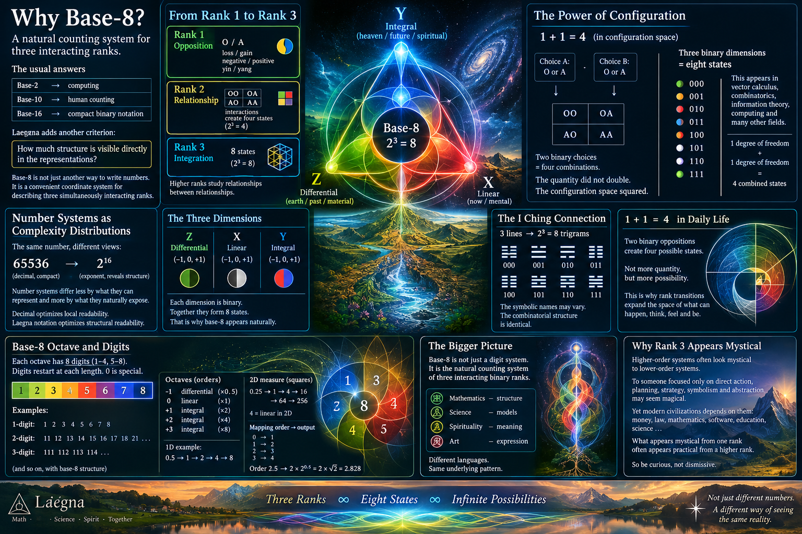

CoPilot's introduction:

# Why Study Base-8 as a Rank System?

Before discussing digits, symbols, trigrams, or I Ching correspondences, it is useful to ask a more fundamental question:

> Why would a base-8 system be interesting at all?

The conventional answer is simple:

```text
Base-2  : computing
Base-10 : human counting
Base-16 : compact binary notation
```

A number system is usually judged by practical efficiency.

Laegna proposes an additional criterion:

> How much structure is visible directly in the representation?

This chapter explores the possibility that base-8 is not simply another way of writing numbers, but a convenient coordinate system for describing three simultaneously interacting ranks.

---

## Number Systems as Complexity Distributions

A recurring theme throughout Laegna Number Systems is that complexity is never removed.

It moves.

For example:

```text
65536
```

is compact in decimal notation.

However, many mathematicians immediately rewrite it as:

```text
2^16
```

because the exponent reveals structure hidden inside the decimal representation.

The quantity stays the same.

The visible organization changes.

This suggests a general principle:

> Number systems differ less by what they can represent and more by what they naturally expose.

In this sense, decimal notation optimizes local readability, while Laegna notation attempts to optimize structural readability.

---

## From Rank 1 to Rank 3

The simplest interpretation of the rank hierarchy is:

```text
Rank 1
    Opposition

Rank 2
    Relationship

Rank 3
    Integration
```

Rank 1 distinguishes between alternatives:

```text
loss / gain
negative / positive
yin / yang
O / A
```

Rank 2 studies interactions between them:

```text
OO
OA
AO
AA
```

This creates four states rather than two.

Rank 3 studies relationships between relationships.

Instead of examining only one opposition, it examines multiple simultaneous oppositions and the consistency between them.

The resulting combinatorial space naturally becomes:

```text
2^3 = 8
```

which is exactly the size of a base-8 octave.

---

## The Meaning of "1 + 1 = 4"

The statement:

```text
1 + 1 = 4
```

is not true in arithmetic.

However, it becomes meaningful in configuration spaces.

Consider two binary choices:

```text
Choice A:
    O or A

Choice B:
    O or A
```

The possible combinations become:

```text
OO
OA
AO
AA
```

There are four possibilities.

The quantity did not double.

The configuration space squared.

This idea appears throughout vector calculus, combinatorics, information theory and computing:

```text
1 degree of freedom
+
1 degree of freedom
=
4 combined states
```

A rank transition therefore often represents expansion of possibility space rather than expansion of quantity.

This distinction is central to understanding Laegna ranks.

---

## Why Base-8 Appears Naturally

After the jump:

```text
2 → 4
```

the next natural step is:

```text
2 × 2 × 2 = 8
```

Three independent binary dimensions create eight possible states.

Mathematically this is ordinary combinatorics.

What makes it interesting is interpretation.

In Laegna, the three dimensions are often represented as:

```text
Z
X
Y
```

or:

```text
differential
linear
integral
```

or:

```text
internal
present
external
```

depending on context.

The important observation is that all three dimensions remain binary, yet their combined space becomes octal.

Base-8 is therefore not merely a digit system.

It is the natural counting system of three interacting binary ranks.

---

## Relation to I Ching

The traditional I Ching trigram system also contains:

```text
2^3 = 8
```

states.

From a Laegna perspective, this is interesting independently of any mystical interpretation.

The mathematical structure alone is sufficient.

Three changing lines naturally generate eight combinations.

The symbolic names attached to those combinations may vary between cultures.

The combinatorial structure remains identical.

Thus one may study:

```text
000
001
010
011
100
101
110
111
```

as pure mathematics,

or as trigrams,

or as logical operators,

or as number-system coordinates.

The underlying rank structure is the same.

---

## Why Rank 3 Often Appears Mystical

A recurring historical pattern is that higher-order organizational systems are frequently interpreted as mystical by lower-order systems.

To somebody operating only with direct physical action:

```text
planning
strategy
symbolism
abstraction
```

may appear magical.

Yet modern civilization depends largely on those activities.

Money, law, mathematics, software, education and science are all examples of symbolic systems producing physical consequences.

For this reason, what appears mystical from one rank often appears practical from a higher rank.

This does not prove every mystical claim.

It simply suggests caution before dismissing higher-order organizational effects.

---

## A Possible Interpretation

Viewed conservatively, Base-8 Laegna does not require any extraordinary assumptions.

The core idea can be stated as:

> Base-2 counts states.
>
> Base-4 counts relationships between states.
>
> Base-8 counts relationships between relationships.

Whether this interpretation ultimately proves useful is an open question.

However, it provides a coherent reason why octal structures repeatedly emerge in:

- computation,
- combinatorics,
- trigrams,
- rank systems,
- multidimensional coordinate systems,
- Laegna representations.

---

## Conclusion

This chapter treats Base-8 not primarily as a numeral base, but as a structural language for three interacting binary ranks.

The essential observation is simple:

```text
2 states
→ 4 relationships
→ 8 rank positions
```

From ordinary arithmetic, nothing new has happened.

From a structural viewpoint, however, each step increases the visible organization of the system.

Whether used for mathematics, logic, computing, I Ching analysis, LaeChing, or future Laegna Physics applications, Base-8 serves as a natural coordinate system for expressing rank-3 structures while preserving direct correspondence to binary foundations.

The following sections explore how those rank-3 structures appear in actual Laegna numbers, multidigit representations, trigrams, hexagrams and higher-order transformations.

---

My initial intro:

# Laegna Base 8 - structural analysis

Laegna base-8 is 3-ranked rank index, or next octave density from base-4.
- Number systems hardly *are* something internally; rather they *are* what they are practical in.

[LaeChing Programming Guide](https://github.com/tambetvali/LaeChing/tree/main/Programming) explains 3 ranks based on I Ching.
- Notice that the mathematics described in I Ching are not necessary mystics, but symbolized, colorized named and memorizable universal rank system;
  - I don't know about SpiReason, but Laegna Science from top to bottom specifically excludes life stories, narratives and particulars and concentrates on factual, numeric or well-defined data which can be proven without mystical experience, supercomputer nor thousands of years of traditions. Altough the tradition might be most often needed and supercomputer sometimes helps; Laegna is not otherwise against mystical experience.
    - This is not very sure: rank 3, in todays terms, is as mystical as rank 2 seemed magical and unbelievably mental for neanderthallean rank. This actually *is* the basic christian and buddhist mystery, and modern civilization, that shortest way to cake might not be physical, and shortest way to gain is often not axe. We will find similar paradox for rank 2 in rank 3.

## Compare with rank 2 systems

To be understood: rank 2 system is not *less* than rank 3, but *different* - when used in context where all ranks are available.

Rank 2 systems concentrate on matters such as:
- Yin, material, short-term.
- Yang, spiritual, long-term.

It's a study to analyze 3 ranks:
- 3 ranks are rank 2 of rank 2 itself, dividing it to yin and yang - this can be thought.
- 3 ranks Z, X, Y contain 2 ranks at least three times:
  - Z => X in octave 1.
  - X => Y in octave 2.
  - Z => Y in octave 3.
  - If all three octaves equal, Laegna truth equals to binary truth and True and False are legal in Laegna, as well as base-2 O and A (which also study either one of two terms, or the diagonal).

Rank 1 and 2 people are often this; let's call it opposition rank 0 or 1 (A):
- **Material yin:** Rank 1 calls themselves material, and is either nash or not in regards to rank 2.
- **Spiritual yang:** Rank 2 calls themselves spiritual, and is either nash or not in regards to rank 1.
  - This is subtle desire, spiritual materialism, extreme idealism etc. which makes it look like materialism, but from above.
- In first order, material and spiritual are contraditing opposites, and no system reaches above yang:
  - Either short or long term is basin for nash behaviour.

Rank 3 calls us to second rank of the same; let's call it opposition rank 1:
- **Material yin:** Rank 1 inside diagonal are *neither* spiritual or material;
  - They fall into spiritual or material class, excluding the other; but the underlying boolean is self-referential in Laegna:
    - If only one channel is used for O and A, 2-channel system does not yield True, altough it might not be completely false. It's not a position.
  - In normal rank order:
    - Material yin of second yang is either material yin or spiritual yang of first rank.
- **Spiritual yang:** in opposition rank 1 or 2 (E), the yang is integration of yin and yang, the Dao:
  - Completely material.
  - Completely spiritual.
  - Goals are evaluated in regards to spirit, and causes and consequences are realistic in regards to body and matter.
- At opposition rank 0, this seems impossible:
  - I am programming and working - attacked by a person for "talking like bill gates", "looking like evil business";
  - I am meditating and training my mind - same person runs so different thread that they come telling me that I'm idealist.
  - They say any higher degree in anything as opposing the other things. For example I get money - therefore, they wont.

We then see four:
- Rank 0 yin, "loss": loser.
- Rank 1 yang, "gain": winner.
- Rank 1 yin, "loss" up to "loss-loss" (all previous values included, loss-loss or loss^2 added):
  - All types of losers in unified paradigm.
- Rank 1 yang, "win-win" (excludes all possibilities except victory squared, win^2, gain^2):
  - This is exponential, accelerating way;
    - Both sides win in same complexity and cost associated with single loss or win in rank 0 - this is horizontal exponent, where 1 + 1 gives 4.

##### How this 1 + 1 = 4; both people win for two, works in vector calculus?

#### Can 1 + 1 Give 4?

In ordinary arithmetic:

```text
1 + 1 = 2
```

always.

However, in vector spaces and combinatorics:

```text
1 degree of freedom
+
1 degree of freedom
=
2 × 2 = 4 states
```

For example:

```text
u = (1,0)
v = (0,1)
```

Together they span:

```text
(0,0)
(1,0)
(0,1)
(1,1)
```

which contains 4 possible positions.

Thus:

```text
1 + 1 ≠ 4
```

as a number,

but:

```text
1 axis + 1 axis
→ 4 combined states
```

is completely normal.

In this sense, the transition:

```text
1 → 2 → 4
```

can be viewed as increasing configuration space rather than increasing quantity.

***This means:*** altough in rank 2 we do not trivially bring 1 chicken both and get 4;
- But we indirectly integrate our combinatoric spaces and get 4.

## Base-8 Rank 3 system

Rank 1 is boolean:
- 1 => O loss
- 2 => A win
- Loss and win: plus and minus.

This system is linear and infinite:
- O might be all negative numbers.
- A might be all positive numbers.
- The center is 0.

Rank 2 is quaternary with four quadrant structure:
- 1, 3 => O
  - 1 => OO loss-loss
  - 3 => AO win-loss
- 2, 3 => A
  - 2 => AO loss-win
  - 4 => AA win-win

Here, both O and A group inside have plus and minus:
- They contain whole infinity of plus and minus numbers.
- O group is literally plus and minus, A group is projected counterpart.

Yet the O and A groups themselves:
- Instead of plus and minus, comparatively next rank operators: multiplication and division can be used.
- Vector operations run around 1, and cannot get through 0 with infinite numbers.
  - The power of precision is same - if complexity of negations inside group are removed, what is left is rank 1 number:
    - If both plus-minus groups are compressed to have plus and minus both in single positive number, the system is 100% same in all interactions, as rank 1 initially was, altough 1 must be moved to zero and some other things done; operation-consistency is 100% that most basic rank 2 ops, now are exactly the rank 1 ops.

Rank 3 is octal number system, which converts to 3 change lines in I Ching:
- 1 <scalarzero> 2 <vectorzero> 3 4 <matrixzero> 5 6 7 8.
- 1 <scalarzero> 2 <vectorzero> 3 <scalarzero> 4 <matrixzero> 5 <scalarzero> 6 <vectorzero> 7 <scalarzero> 8.
- Consider this:
  - This is a normalized system, so all three zeroes are equally important;
    - Altough higher rank zeroes are much higher to cross, which is added value. Who has crossed spiritual zero, soon learns that material is equally important, achieving win-win rather than struggle of two existing things, mind and matter.

Rank 3:
- Has 5, 6, 7, 8 heavily accelerated.
- Rank 2 has 3 and 4 accelerated, but this might be lost in normalization.

Because of these divisions, also:
- Numbers, from 1 to 8, in each contained infinity, form a single, linear progression.
  - Number properties change on the way.
  - For this reason, it's unified whether we use it for 3 ranks or 1;
    - Altough 1 octave in 3 ranks might fully mean multiplication by 8, a 3-dimensional octave.
      - While in it's linearized use it's still 2.

# Multidigit ranked numbers

Consider normal laegna numbers: two-band number with higher and lower frequency, written to 2 integral lines.

Rank 3:
- 3 bands.
- 3 integral lines.
- Complete universal system.

Each bit is in one of the groupings:
- Bit 1: 1357 <-> 2468.
- Bit 2: 1256 <-> 3478.
- Bit 3: 1234 <-> 5678.
- This reflects on traditional computing.
- This reflects on three lines, an element symbol in I Ching.

Consider this number:
- 1228

Bits:
```
1 => 000
2 => 001
2 => 001
8 => 111
```

Bands:
```
Y: 0111. Integral 1 exponential. Octave 1.
X: 0001. Linear. Octave 0.
Z: 0111. Differential 1 logarithmic. Octave -1.
```

There is absolute symmetry of bands, digits and linear growth.

# Two hexagrams - internal and external

Higher hexagram in I Ching converts to "heaven":
- This is the direction outside-in; 8 means external collapse, while coming down by *external octaves*.
  - Sequence: Infinity, Infinity / 2, etc.
  - Infinity is a number.
  - Zero is unapproachable limit.

Lower hexagram in I Ching converts to "earth":
- This is inside-out, the normal dimension we see:
  - Sequence: 0, 1, 2 etc.
  - Zero or one is a number.
  - Infinity is unapproachable limit.
 
This makes up 6 ranks - 6 change lines.

**Y**: 6 ranks can be read linearly:
- Each of change lines is one scope, containing infinity inside or divided by infinity where normal arithmetics is used.

**X**: They can be read as they appear:
- 8 possibilities are 8 possibilities:
  - In I ching it converts to elements, trigrams.

**Z**: All their combinations exist, and they are 64:
- Zoom in and you see them clearly as separate dimensions;
  - As you go through all 8 combinations in both, you get 64 actual ranked combinations.

In Laegna, the higher hexagram is R, lower is T:
- RT RT RT RT - this is way to write it; such as 12 45 62 74 - 4 digits with R and T.
- One can be written above the other; line is typically split to higher and lower half, both contain digits.
- Or hexademical can be used.

# Relations

Base-8 number relates to base-4:
- Possibly: It divides base 4 by additional plus and minus into two base-4's.
- Base-4 has 2 channels to contemplate on any 2 in base-8 4 channels.
- Theorems often occur in base-4, so that base-8 has horizontal, vertical and diagonal.
- Base-4 numbers do not break when they are used for base-8 information.
- Base-16 down to base-8 is external difference of base-4.

Molecularly, base-8 and base-4 can be used together very well:
- Often, base-8 would express ranks, while base-4 expresses numbers inside each.

Base 16 is combinatoric field, 64 possibilities of 2 base 8 digits.

# Multidigit

1228, example number I brought before:
- It has same density at each rank - laegna numbers are always synchronized (it's possible, but harder to have one of the bands missing at only some digits).
- It turns ranks into fractal structure;
  - But does not lose the case: most interesting properties where other systems might not be better, are exactly in this harmonic reading of *three bands*.

# Complexity

I Ching / LaeChing hexagram is ideal rank system:
- Below is the negative complexity: combinations appear mystical, whole infinity cannot depleat them.
- Above is the positive complexity: no new combinations appear, external combinations are randomly missing or out of place, so the complexity of many operations might raise.
- Base-8 is the ideal mean for rank and complexity measures.

# Rank-smooth number

Write this:
- 12281228.

One can make it so:
- First 4 digits for rank.
- Second 4 for content.
