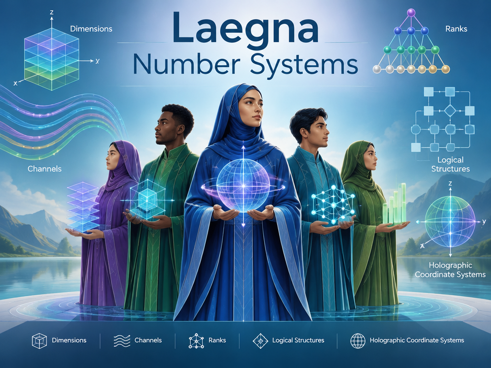

<br>

Article by CoPilot:

# LaegnaNumberSystems

This repository contains general introductions, explanations and experiments related to **Laegna Number Systems**.

Laegna Number Systems are developed together with **Laegna Logecs** and **Laegna Physics**, and attempt to answer a simple question:

> What happens when a number system is optimized for structure, recursion, self-reference and infinity, instead of primarily being optimized for local measurement?

The answer is not that decimal numbers become invalid.

The answer is that **the distribution of complexity changes**.

---

## The central idea

Every sufficiently expressive number system can represent the same quantities.

A decimal number can be converted into binary.

A binary number can be converted into hexadecimal.

A hexadecimal number can be converted into decimal.

Likewise, a Laegna number can always be represented through ordinary digits.

The question is therefore not:

> "What can be represented?"

The question is:

> "Where does the complexity appear?"

Decimal notation is extraordinarily efficient for local quantities:

```text
12
985
1264
52367
```

Humans read such values almost instantly.

However, as systems become increasingly recursive, self-referential, infinite, hierarchical or holographic, a significant amount of work moves from arithmetic into interpretation.

The structure becomes harder to see than the value.

Laegna proposes the opposite tradeoff.

Local numbers become somewhat less convenient.

Large-scale structure becomes increasingly visible.

---

## Cheetah and human

An intuitive analogy is biological evolution.

A cheetah can run over 100 km/h.

A human cannot.

For a short sprint:

```text
Cheetah wins.
```

For a persistence hunt lasting many hours:

```text
Human often wins.
```

The human did not become superior by maximizing local performance.

Humans lost many local advantages:

- weaker claws
- weaker teeth
- slower sprint speed
- weaker immediate attack capability

Instead, evolution optimized planning, endurance and long-range coordination.

The result is a system that appears weaker locally, yet becomes stronger globally.

Laegna and decimal numbers may be viewed similarly:

```text
Decimal:
    locally efficient

Laegna:
    globally efficient
```

Neither system is universally superior.

The advantage depends on scale.

---

## Complexity gates

This repository operates from a conjectural principle:

> Complexity does not disappear.
>
> It changes location.

For small-scale calculation:

```text
17
85
1264
```

decimal notation is exceptionally efficient.

For recursive structures:

```text
hierarchies
self-reference
proof chains
infinite limits
rank transitions
```

the complexity of decimal descriptions grows rapidly.

Laegna attempts to move part of that complexity into the notation itself.

In other words:

```text
Decimal minimizes local complexity.

Laegna minimizes recursive complexity.
```

---

## Ranks

The language used throughout these repositories often refers to **ranks**.

A rank is not merely a larger quantity.

A rank is a larger organizational class.

For example:

```text
Scalar
→ Vector
→ Matrix
```

may be viewed as rank transitions.

Likewise:

```text
Point
→ Line
→ Surface
→ Volume
```

may be viewed as rank transitions.

The core observation is:

> Higher ranks often contain rules which are difficult to express from lower ranks.

Laegna systems attempt to expose those transitions directly.

---

## Decimal and Laegna

Within this repository, decimal notation is often treated as a primarily finite, local system.

Laegna notation is often treated as a recursive, rank-oriented system.

A simplified comparison might look like:

| Decimal | Laegna |
|----------|----------|
| Local values | Recursive structures |
| Finite scale efficiency | Infinite scale efficiency |
| Compact everyday numbers | Compact rank descriptions |
| Human counting | Structural positioning |
| Measurement-first | Structure-first |

Both systems remain computationally complete as number systems.

The distinction concerns practical organization of information.

---

## Why base-4?

Laegna frequently uses four primary logical states:

```text
I
O
A
E
```

These originate from Laegna Logecs.

In many Laegna representations, numbers and logic are not separated as sharply as in conventional mathematics.

The same symbols may simultaneously represent:

- logical positions
- numerical positions
- structural positions
- recursive states

This allows certain patterns to remain visible that otherwise become hidden inside long digit sequences.

For example:

```text
65536
```

and

```text
2^16
```

represent exactly the same quantity.

Yet many people immediately recognize more structure in the exponent form.

Laegna extends that idea:

A useful notation should reveal structure, not merely store values.

---

## Self-reference

One recurring motivation within Laegna is self-reference.

Sequences such as:

```text
1
2
4
8
16
```

can be viewed as repeated application of a previous operation.

The output becomes the next input.

This recursive reuse of a result appears throughout:

- growth
- exponentiation
- iteration
- integration
- physical processes
- temporal evolution

In Laegna terminology, these self-referential transitions are often associated with higher ranks.

Much of Laegna Number Systems is therefore an investigation of how recursive structures may be represented explicitly rather than indirectly.

---

## Local and global efficiency

An important observation is that both systems exchange advantages.

For example:

```text
985
```

is easier to read in decimal.

However:

```text
0.0012232 × 10^64
```

already requires interpretation.

As scale increases, the value itself often becomes less important than its structural location.

At sufficiently large scales it may become advantageous to normalize patterns rather than digits.

This is one of the major motivations behind Laegna notation.

---

## Relation to other repositories

This repository should be viewed together with:

- Laegna Logecs
- Laegna Physics
- related Spireason materials

A simplified dependency tree is:

```text
Laegna Logecs
        ↓
Laegna Number Systems
        ↓
Laegna Physics
```

Where:

```text
Logecs
    = logical structure

Number Systems
    = coordinate structure

Physics
    = measurement structure
```

Number Systems acts as the bridge between logic and measurement.

---

## Conjectures and theorems

Many ideas contained within the Laegna ecosystem are exploratory.

Some observations are straightforward mathematical statements.

Others are hypotheses.

Others are philosophical interpretations.

Throughout this repository it is useful to distinguish:

```text
Theorem
    proven statement

Conjecture
    suggested statement

Model
    useful representation

Metaphor
    explanatory comparison
```

This distinction allows the system to grow while keeping experimental ideas separate from established results.

---

## What this repository explores

This repository explores the possibility that number systems may be evaluated not only by:

- accuracy
- compactness
- computational efficiency

but also by:

- structural visibility
- recursive visibility
- self-referential visibility
- rank visibility
- infinity visibility

The goal is not to replace decimal arithmetic.

The goal is to investigate whether alternative coordinate systems can make certain classes of problems appear simpler, more symmetric, or more intuitive.

---

**This repository will gradually introduce the various paradigms, representations, operations and interpretations that together form Laegna Number Systems.**

---

My Initial:

# LaegnaNumberSystems
This is for general overviews of Laegna Number Systems.

Decimal number system is rank 1 - it operates in finite spaces. Laegna number system is rank 2 - it operates in infinite spaces. Or one could use 0 and 1.

In Decimal systems, ranks are magic of numbers 2 and 5 combined - 2 is X, 1 + 4 is Z + Y; number structurally both primes can be viewed separately, and thus it has potential for roughly the linear realm 2 and "averaged" (combined) log-exp realm. 5, also, acts well as boundaries of 4 - 4 1-width slices need 5 ending points. This means from outside, one calculates diagonal, and one can then see that diagonal touching 4 has 5 limits - if 5, in diagonal, to outside, draws 4, then once again 4 is 2 in second power and so, 2 is reflected by 4 and large or very small numbers are somewhat linear:
- This way of seeing some infinity structures does not guarantee easy solvability - to put 5 backwards to achieve external 4 which projects to internal 2, because internal is the previous octave symmetric - here we can see *2 and 5, in finite settings, behave way better* - infinite limits are not trivial to take, and values themselves might look bad; they look like irrational numbers - something to be repeated to infinity.

In Laegna system:
- Lower channel can show the internal 2.
- Higher channel can show the external 2.
- Relatively, they do not appear inverted, symbolized, nor complex.

Laegna number system is rank 2 number system:
- Very efficient for understanding and calculating infinity, less efficient as one approaches local scope.
- Decimal system approaches local scopes very well, gets complex in infinity.

# Ranked example

Russell did not manage to connect math and logic because of liars paradox; nor did Turing say every model will be completed and every calculation automated:
- We can say true and false, binary logic, and decimal system are entangled whole.

What happens with decimal system?
- Laegna logical letter E is self-referential, square of A, so the formulae which built A, will be applied again.
- Thus E is self-referential:
  - E solves self-referentiality in lowest degree;
    - For example 1, 2, 4: 1*2 is 2. Now take 2, and multiply by 2: to get into 4, one does a self-reference - output of 1\*2, becomes input of 2\*2.
      - 4 is value of E, and 1 => 2 operation, is then, repeated as 2 => 4 operation, where the initial operation is applied to result.
    - Here: to achieve second rank complexity class 2, which is 2 * 2 = 4, is undoable in binary system.
      - Every next order is inside this structure: rank 2 solves the proof structure of any further ranks, because:
        - To accelerate from 4 to 8, as next step:
          - Moves the slider from 1 to 2, which is already solvable, and *can* self-reference 2\*2 now, into next step 4\*2.
            - Because the first combinator is tautological, the structure which points self-referentiality in 4, can easily be located, and applied as a theorem of next step.
      - Turing, Russel, and me: show that there is now way to achieve rank 2 with binary or decimal system:
        - Decimal system breaks for very similar reasons - altough integration and exponentiation exist, aligned with binary logic *it cannot show what it did*, so exponentiation is either known, or not found.
      - So the rank 2 complexity in decimal system is infinite.

What happens with Laegna system?
- From rank 2 and beyond, it seems simpler and simpler compared to decimal system.
- Coming down to local, zeroeth- / first-rank group, the complexity of using 4 choices for binary pairs which appear, means the decimal-binary complexity is smaller here.
  - Where one manages to separate a single, low-ranked model from high-ranked system, decimal and binary is often more efficient.

How to see this:
- 4-number system is symmetric to infinity and beyond; multiplication and division have symmetry to zero and above.
  - Most of these complex operations are very easy in Laegna Logecs.
- Binary system has certain very simple models which can be analyzed in Laegna:
  - For example, generic model of good and bad has very small number of combinations, altough it operates with local and global.
    - This model is heavily criticized (biblic God in Garden of Eden, Buddhism and Daoism, Nietzsche "beyond good and bad" - just a few examples).
      - Modern life complexity is mostly seen in binary logic.
  - Now:
    - The binary model has several times less complexity than Laegna model, because it's repeated three times in Laegna identical system to have it fully declared; using O and A is what I mean by Laegna binary representation and one can map I, O, A, E three times to O and A, and resolve the model with seemingly binary logic, which is what I do in Laegna. Then, if a fact holds horizontally, vertically and diagonally, i.e. E holds like this, in such case it can be called True, and opposite case on all three is False. Not all systems can come to True and False trivially, but there is always some remapping.
- 4-base numbers:
  - I have seen from beginning that in rank 0/1 number systems, base-4 is highly inefficient;
    - Base-10 can be used to write the same numbers in more compressed, and easier-to-read way, and native to 10 fingers.
    - At certain complexity, numbers like 0.0012232 * 10^64 become complicated, while Laegna can often normalize similar types of numbers into single A, E, or something like EEEE, and still catch the precision. It can also directly understand if small-case digits (i.e. after dot/comma) make it preciser: the digit positions are logical, and last digits map the local digits.
      - Such normalized way becomes easier *as soon as the precision humans easily understand ends*.

Here, rank 1 and rank 2 (alt. 0 and 1):
- They might be future words in Laegna to separate these systems;
  - The same way we separate scalar, vector and matrix operations to three symmetric ranks:
    - Just so many people learn only scalar operations and get an overview of the rest;
      - Laegna is itself third-rank system through base-8 system, and makes it simple; decimal system has rank 3 mostly more complicated - but at certain complexity, it's *unavoidable*.
     
So, the counting:
- Before berber's-turing's paradox: systems which only have 2 states as basin, are directly very simple compared to 4 state systems, in case they are looking at models which match the structure. Many ideal models do, and O and A, or True and False, are used in Laegna.
  - Laegna system complexity, with such class, can become four or more times more complex than decimal-binary system.
- From berber-halting-liar's self-referential paradox, Laegna number complexity does not grow much, but binary-decimal complexity grows to infinity:
  - One can prove sequences such as integral and expansion, which are by definition, time-ordered self-referential systems;
    - It cannot finalize the proofs:
      - The piece of self-referentiality, tautological in Laegna, *can never be completed in binary decimal logic*:
        - This does not mean turing-complete sets of arbitrary calculations cannot be done;
          - This means proofs and automata are not available, so the system is "blind".
        - We say that *quaternary system is topologically incompatible with binary or decimal systems* - 2 and 5 can map finite areas, but not the final solidity:
          - For example, IQ system 0% to 200% was originally defined to be internal and external: 100% is average, 0% is internal limit, and 200% is external limit.
          - Notice that 0 to 200 literally means *discrete counting*, whole numbers; in this logic one can write 124.5, 124.25; one can do operations with 124.1 - but it's not guaranteed that it remains readable and linear with any more complex systems, because *position of dots, always follows very small integer and it's the last counted position of external boundary*.
            - We can see *people naturally apply such digit periods*, for example if one gets 50.4, they often write 50.5, or if they get 41.48, they write 41.5 - this can be seen as rounding, but rather, *they make manually sure they can imagine the system proportions*.
              - This means either psychologically, mathematically or logically, it's never guaranteed one can *actually utilize local precision of decimal systems for such calculations*, rather they write the % part normally, and try to use only some prime configurations below. With 123.456%, one instantly loses all consciousness - inside operations, one must just keep an eye on too much things to guarantee comparison and operation logic, and that it does not distort after a few operations.
             
---

***This repository will go through various things Laegna Number System can represent, and explain it logically***.

Where we use it: Laegna Physics heavily needs this thing, because conversions, rather than being mathematically linear, must do this:
- From one linear world, land smoothly to another linear world.
  - But rank 1 and rank 2 number systems necessarily see it all differently;
    - In decimal system, complexity is seeing the whole, unifying the scopes etc.;
    - In laegna system, complexity is seeing wide ranges of local numbers within their random basin:
      - Decimal system actually - with 0 to 200 already, has random disproportions which *require one to use topological basin and active thought*, because the random element constantly appears, such as losing the last infinitesimal of 0.(9) which becomes 1.0, or such as having square root of two, trivially basic number, just very very irrational.
      - Things such as square root of two: in Laegna numbers, the irrationality is easily gone.
